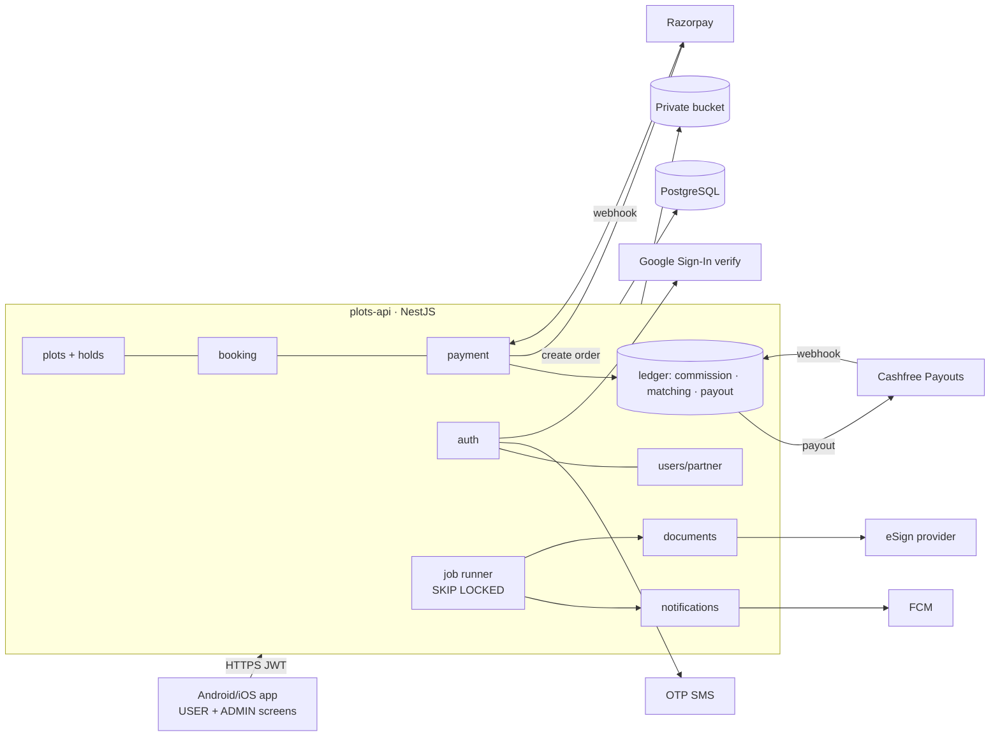
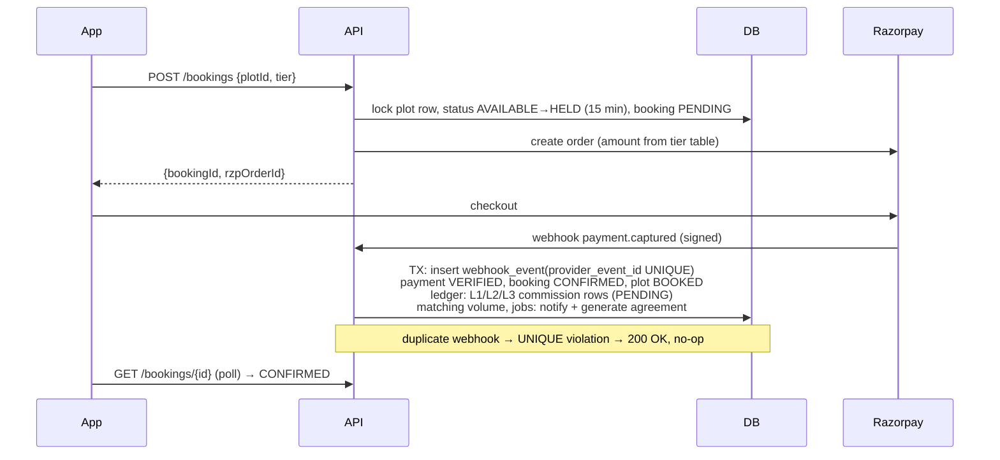

# Architecture Decision — 315 PLOTS Backend

## The key insight first

"Microservices vs monolith", "event-driven", "clean architecture" are not rival
options. They answer three separate questions:

| Axis | Decision |
| --- | --- |
| **Topology** (how many deployables) | **Modular monolith**: one NestJS app, one Postgres |
| **Flow & data** (how state moves) | **Request/response + an append-only ledger** for money. Async work goes through a DB job table (transactional outbox) |
| **Code shape** (inside a module) | **Layered**, with **ports & adapters only at the 4 vendor edges** (payment, payout, eSign, OTP/push) |

The product is small in volume: 315 plots, a few thousand users. Its risk is in
correctness: money, commission and double booking. Spend the complexity budget on
correctness, and keep the topology simple.

## The constraints that actually decide it

- **C1 — Money correctness.** Payments, 3-level commission, matching and payouts must be auditable, idempotent and server-authoritative (PDF §2, §8).
- **C2 — Finite, contended inventory.** There are exactly 315 plots. Two users must never book the same plot, which needs a transactional hold with expiry.
- **C3 — Webhook-driven truth.** Booking and commission events happen only after a verified provider webhook (Razorpay in, Cashfree Payouts out). Duplicate webhooks are expected.
- **C4 — Small scale.** About 315 bookings over the project's life, with users in the low thousands. Peak load is a launch-day burst of perhaps 50 rps.
- **C5 — Small team.** Probably 1–3 backend devs (TypeScript/NestJS chosen by the team) and immature on-call.
- **C6 — Two roles only.** `USER` (buyer + referrer in one account) and `ADMIN`. Partner approval is an admin action on a user, not a separate role.
- **C7 — Four vendor integrations** (payment, payout, eSign, OTP/push). Each may be swapped (PDF: "provider abstraction").
- **C8 — Sensitive data.** Bank details, agreements and receipts need encryption at rest and time-limited URLs.

## Every pattern, scored

### Topology
| Pattern | Verdict | Why |
| --- | --- | --- |
| Modular monolith | **ADOPT** | C4 load fits on one box. C1 needs single-DB ACID across booking → payment → commission. C5 rules out multi-service on-call |
| Microservices | REJECT | Splitting booking and commission would turn one DB transaction into a distributed saga (C1). There is no scaling pressure (C4) |
| Serverless | REJECT | Cold starts, plus scheduled hold-expiry and webhook retries spread across functions. No benefit at C4 scale |
| SOA / P2P | N/A | Nothing to integrate internally |

### Flow & data
| Pattern | Verdict | Why |
| --- | --- | --- |
| Request/response (REST) | **ADOPT** | The mobile app needs it, and every screen is a CRUD/status read |
| Append-only ledger | **ADOPT (scoped to money)** | C1 requires auditable financial state changes. Ledger rows are never updated, and reversals are new rows |
| Transactional outbox / DB job queue | **ADOPT** | C3: webhook → commit state + enqueue jobs (commission, notify, docs) in the same transaction. Uses `SELECT … FOR UPDATE SKIP LOCKED`, so no broker is needed |
| Event sourcing (whole app) | REJECT | The ledger already provides audit for money (C1). Event-sourcing profiles and plots adds cost and no value |
| Message broker (Kafka/RabbitMQ) | DEFER | The outbox table handles C4 volume. Revisit above ~100 jobs/s |
| CQRS | REJECT | No read/write asymmetry at C4. Dashboards are SQL aggregates |
| Batch | SCOPED | Nightly reconciliation against Razorpay/Cashfree only |

### Code shape
| Pattern | Verdict | Why |
| --- | --- | --- |
| Layered (controller → service → repo) per module | **ADOPT** | C5: boring and familiar |
| Ports & adapters | **SCOPED** | Only for C7 vendors (`PaymentGateway`, `PayoutGateway`, `ESignGateway`, `OtpSender`, `PushSender`) |
| Full hexagonal/clean everywhere | REJECT | Interfaces with one implementation everywhere, which only costs time for C5 |
| Microkernel | N/A | No plugin requirement |

## The recommendation

> **One NestJS (TypeScript) modular monolith on PostgreSQL, where every rupee moves
> through an append-only ledger written in the same transaction as the verified
> webhook that caused it.**

### Deployables
| Deployable | Scales by | Deploys |
| --- | --- | --- |
| `plots-api` (NestJS container; one image runs the API + scheduler) | Vertical first, then 2 replicas behind an LB (jobs are safe with `SKIP LOCKED`) | On merge to main |
| PostgreSQL 16 (managed) | Vertical | — |
| Object storage (S3-compatible, private bucket) | — | — |
| Admin panel | Same API under `/admin/**`; the Kotlin admin screens from the UI call it | With the app |

No separate job worker: it runs in the same process. Split it out only if job latency
hurts API latency (see "When to change").

### Topology

### Critical workflow — payment to commission

### Why this beats the alternatives
| Instead of | What breaks |
| --- | --- |
| Microservices (booking / payment / commission) | The webhook must update 3 services atomically, which needs a saga and compensations. A partial failure means a paid booking with no commission (C1) |
| Firebase/Supabase-only backend | Commission and matching logic plus webhook verification end up in cloud functions with no ACID across documents (C1, C2) |
| An ORM (Prisma/TypeORM) | Row locks, `SKIP LOCKED`, partial unique indexes, triggers and recursive CTEs are the safety net here; raw SQL via `pg` keeps them visible and testable |
| Kafka between modules | A second system to run for about 315 events (C4, C5) |

### The one rule that keeps this honest
**Only the `ledger` module writes ledger tables, and ledger rows are never
`UPDATE`d or `DELETE`d.** Enforce it with:
1. DB: a trigger rejects every `UPDATE`/`DELETE` on `ledger_entry` and `ledger_entry_status` (tested in e2e).
2. Code review: only `src/ledger/` may contain SQL that writes `ledger_*` or `match_*` (grep check in CI: `grep -rlE "(insert into|update) (ledger_|match_)" src | grep -v src/ledger/` must be empty).

## When to change this
| Signal | Then |
| --- | --- |
| Job runner p95 lag > 30 s, or it steals API CPU | Run a second container with `JOBS_ENABLED=true` and set it `false` on API replicas |
| More projects than 315 plots (multi-project) | Add `project_id` and keep the monolith |
| > 100 jobs/s sustained | Swap the outbox drain to a broker. Module code is unchanged |
| A separate team owns commission | Extract `ledger`. Its tables are already isolated |

## Risks worth naming before you build
1. **Legal/regulatory (blocker).** A multi-level, 3-level referral with a 70:30 binary matching bonus on real-estate sales can fall under India's **Prize Chits and Money Circulation Schemes (Banning) Act, 1978** and the **Consumer Protection (Direct Selling) Rules, 2021**. RERA agent registration may also apply. **Get a legal opinion before launch.** Razorpay/Cashfree may also refuse or freeze MLM-type merchants (VERIFY their prohibited-business lists).
2. **TDS.** 5% TDS on commission (Sec 194H, VERIFY rate and threshold) needs PAN capture and quarterly filing. KYC was removed from the app, but PAN is still legally required for TDS. Collect it at payout setup.
3. **Matching rule is under-specified.** "Power leg 70% / weaker leg 30%, bonus 50% of matched volume" does not define how legs are formed (binary placement vs largest-subtree), carry-forward, or caps. **This is the #1 open question.** See SRS A-4.
4. **Vendor facts to VERIFY:** Razorpay webhook signature scheme and retry policy, Cashfree Payouts beneficiary/transfer APIs and webhooks, and eSign provider choice (Leegality / Digio / Aadhaar eSign).
5. **Plot hold expiry vs late webhook.** Payment captured after the hold expired and another user grabbed the plot leads to an auto-refund path (FR-4.6).
